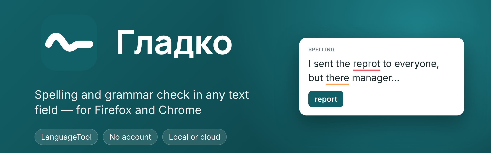
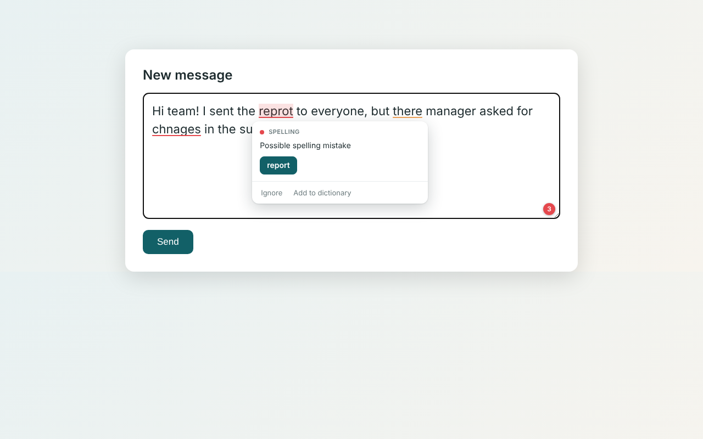
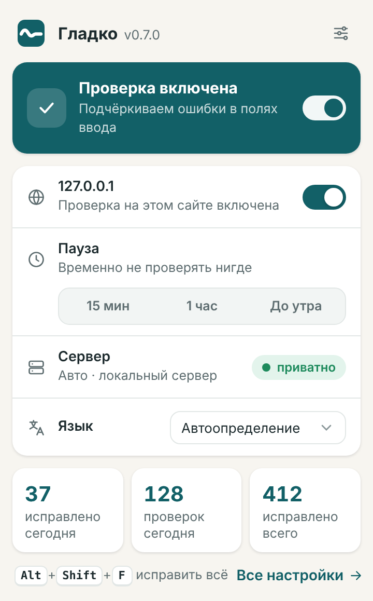
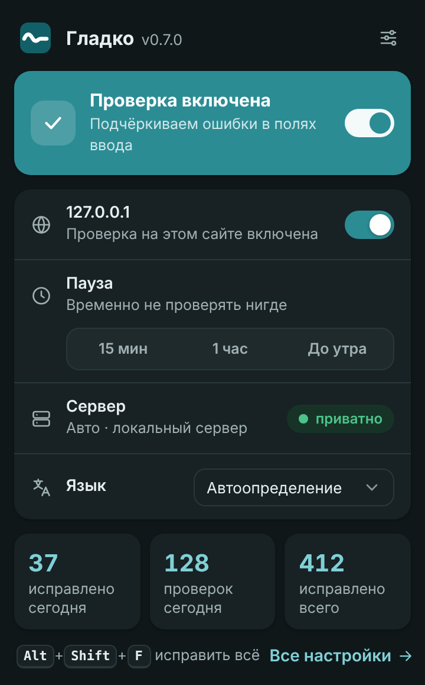
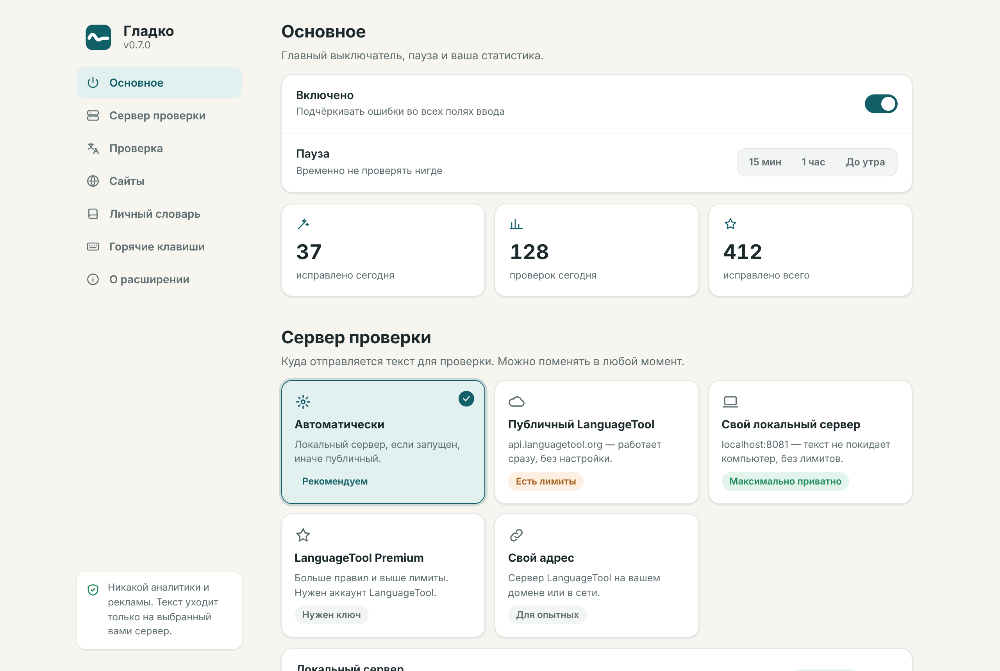
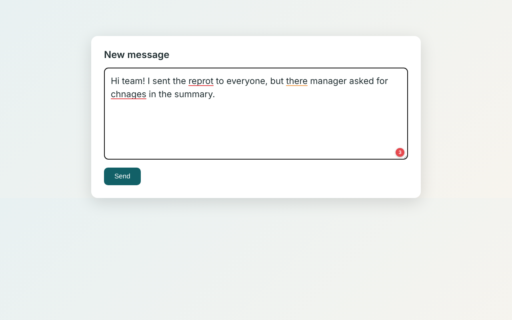
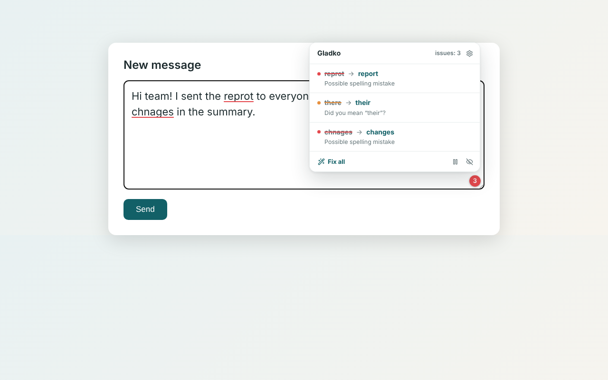

<div align="center">



[🇷🇺 Русский](README.md) · **🇬🇧 English**

[](https://github.com/Oxyg1/gladko/actions/workflows/ci.yml)
[](CHANGELOG.md)
[](LICENSE)


[](https://languagetool.org)

</div>

**Gladko** underlines mistakes in any text field — email, chats, forms, editors — and fixes them in one click. It works with the public LanguageTool server or your own, in which case your text never leaves your computer.

<div align="center">

</div>

## ✨ Features

| | |
|---|---|
| 🔤 **Spelling, grammar, punctuation, style** | Russian, English, German, Ukrainian, French, Spanish and more; automatic language detection |
| ⚡ **Fast and rate-limit friendly** | per-paragraph checking with a cache — only the edited paragraph is re-sent; a request queue keeps you under public API limits |
| 🖱️ **One-click fixes** | suggestion card, "Ignore", "Add to dictionary", "Fix all" |
| ⌨️ **Hotkeys** | <kbd>Alt</kbd>+<kbd>Shift</kbd>+<kbd>F</kbd> fix all · <kbd>N</kbd> next issue · <kbd>P</kbd> pause for an hour |
| 🎯 **In your control** | pause, per-site disable, picky mode, check selected text from the context menu |
| 📚 **Personal dictionary** | import and export as a text file |
| 🔒 **Privacy** | no analytics, no servers of our own; local mode keeps text on your machine |
| 🌍 **UI languages** | Russian and English |

## 🎛️ Menu and settings

Click the toolbar icon for a quick menu: main switch, "check on this site", pause, server, language and today's stats. Full settings are organised into sections, in light and dark themes. A welcome page with a live demo opens after install.

<div align="center">
&nbsp;

</div>

<details>
<summary><b>More screenshots</b></summary>

<br>


</details>

## 📦 Install

| Browser | How |
|---|---|
| **Firefox** | addons.mozilla.org listing — *in review*. For now, download `gladko-firefox-*.zip` from [Releases](https://github.com/Oxyg1/gladko/releases) |
| **Chrome / Edge / Brave** | Chrome Web Store — *coming soon*. For now, download `gladko-chrome-*.zip`, unzip, open `chrome://extensions`, enable Developer mode → Load unpacked |

## 🔧 Check servers

| Mode | What it is | Privacy |
|---|---|---|
| **Automatic** | your local server if running, otherwise the public one | depends |
| **Local** | `localhost:8081`, no limits | text stays on your computer |
| **Public** | `api.languagetool.org` | text is sent to LanguageTool; rate-limited |
| **Premium** | `api.languagetoolplus.com`, needs e-mail and API key | same as public, higher limits |
| **Custom** | any LanguageTool server; access is requested separately | up to you |

```bash
docker run -d --name languagetool -p 8081:8010 erikvl87/languagetool
```

## 🛠️ Development

```bash
git clone https://github.com/Oxyg1/gladko.git && cd gladko
npm install
npm test && npm run build && npm run lint:firefox
```

See [CONTRIBUTING.md](CONTRIBUTING.md). Privacy policy: [store/PRIVACY_POLICY.md](store/PRIVACY_POLICY.md).

## 📄 License

[MIT](LICENSE). Spell and grammar checking by [LanguageTool](https://languagetool.org) (LGPL). Gladko is an independent project and is not affiliated with LanguageTool.
