<div align="center">

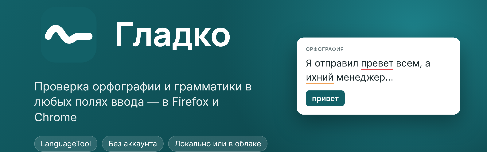

<a href="https://addons.mozilla.org/ru/firefox/addon/%D0%B3%D0%BB%D0%B0%D0%B4%D0%BA%D0%BE-%D0%BF%D1%80%D0%BE%D0%B2%D0%B5%D1%80%D0%BA%D0%B0-%D0%B3%D1%80%D0%B0%D0%BC%D0%BC%D0%B0%D1%82%D0%B8%D0%BA%D0%B8/"></a>

**🇷🇺 Русский** · [🇬🇧 English](README.en.md)

[](https://github.com/Oxyg1/gladko/actions/workflows/ci.yml)
[](CHANGELOG.md)
[](LICENSE)
[](https://addons.mozilla.org/ru/firefox/addon/%D0%B3%D0%BB%D0%B0%D0%B4%D0%BA%D0%BE-%D0%BF%D1%80%D0%BE%D0%B2%D0%B5%D1%80%D0%BA%D0%B0-%D0%B3%D1%80%D0%B0%D0%BC%D0%BC%D0%B0%D1%82%D0%B8%D0%BA%D0%B8/)

[](https://languagetool.org)

</div>

**Гладко** подчёркивает ошибки в любых текстовых полях — в почте, мессенджерах, формах и редакторах — и исправляет их в один клик. Работает с публичным сервером LanguageTool или с вашим собственным: тогда текст вообще не покидает компьютер.

<div align="center">
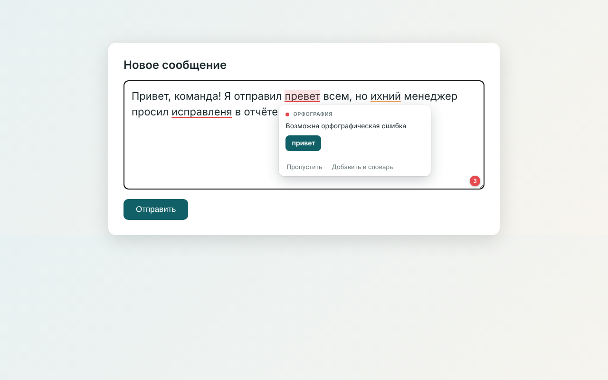
<br><br>
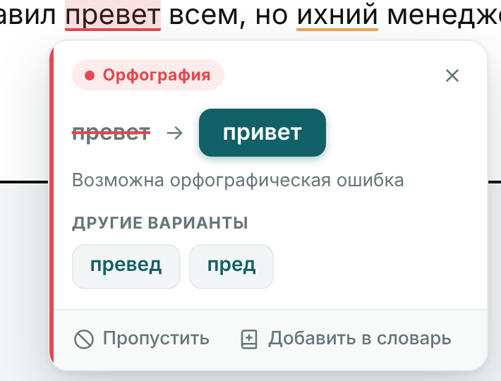&nbsp;
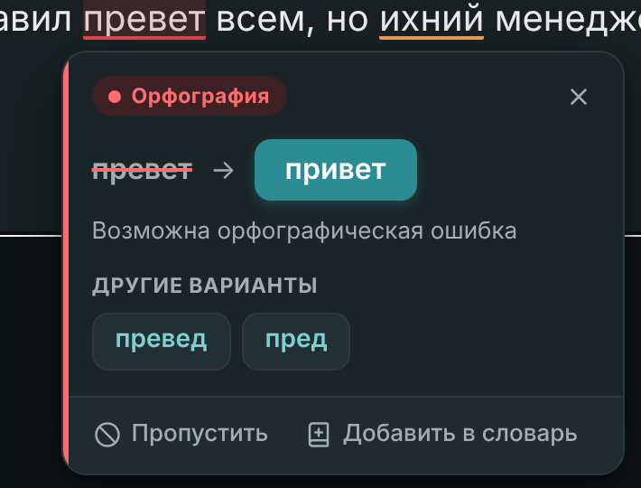
</div>

## ✨ Возможности

| | |
|---|---|
| 🔤 **Орфография, грамматика, пунктуация, стиль** | русский, английский, немецкий, украинский, французский, испанский и другие языки; язык определяется автоматически |
| ⚡ **Быстро и бережно к лимитам** | проверка по абзацам с кэшем: при правке заново уходит только изменённый абзац; очередь запросов не даёт упереться в лимиты публичного API |
| 🖱️ **Исправление в один клик** | карточка с вариантами, «Пропустить», «Добавить в словарь», «Исправить всё» |
| ⌨️ **Горячие клавиши** | <kbd>Alt</kbd>+<kbd>Shift</kbd>+<kbd>F</kbd> — исправить всё · <kbd>N</kbd> — следующая ошибка · <kbd>P</kbd> — пауза на час |
| 🎯 **Под контролем** | пауза, отключение на выбранных сайтах, строгий режим, проверка выделенного текста из контекстного меню |
| 📚 **Личный словарь** | импорт и экспорт в текстовый файл |
| 🔒 **Приватность** | никакой аналитики и собственных серверов; локальный режим — текст остаётся на вашем компьютере |
| 🎛️ **Удобное меню** | быстрые настройки по клику на значок, индикатор паузы и выключения на кнопке, статистика исправлений |
| 🌍 **Интерфейс** | русский и английский, светлая и тёмная тема |

## 🎛️ Меню и настройки

Клик по значку на панели открывает быстрое меню: главный выключатель, «проверять на этом сайте», пауза, сервер, язык и статистика за день. Полные настройки разложены по разделам, есть светлая и тёмная тема. После установки открывается страница приветствия с живым демо.

<div align="center">
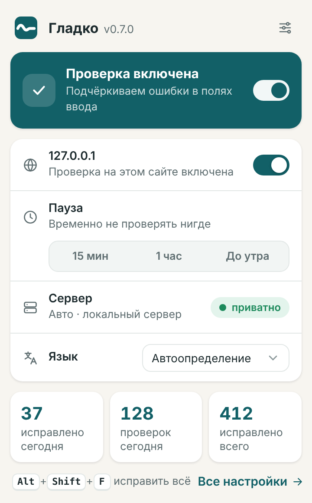&nbsp;
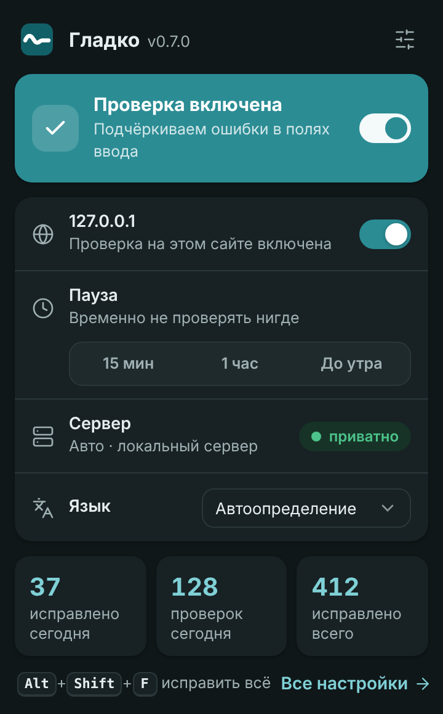
<br><br>
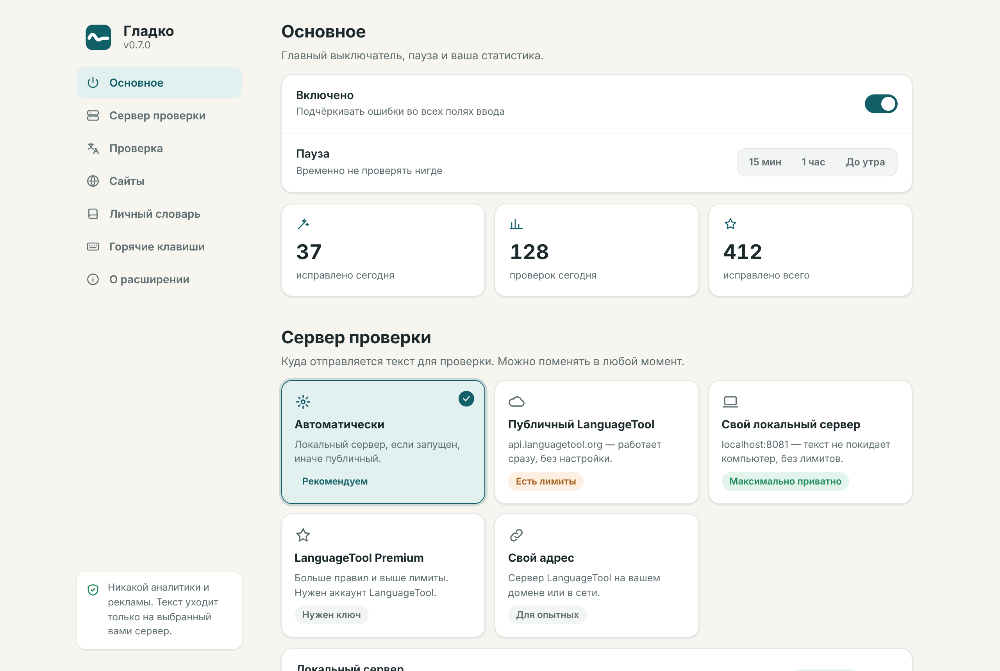
</div>

<details>
<summary><b>Больше скриншотов</b></summary>
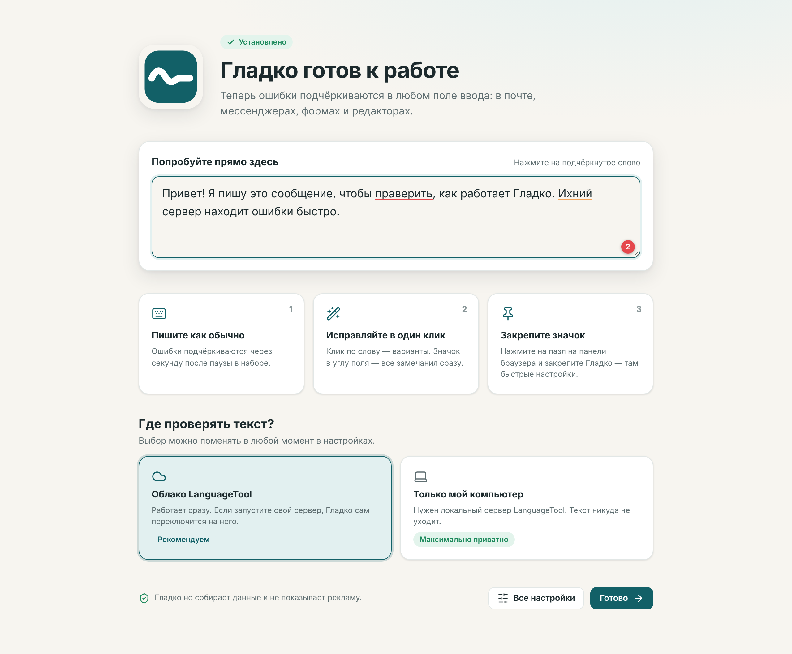
<br>
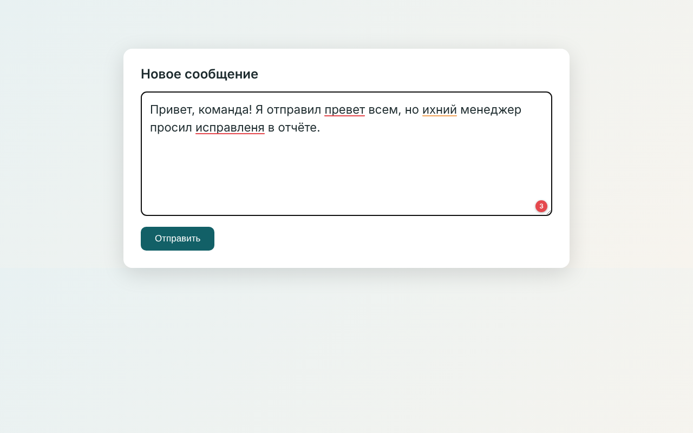
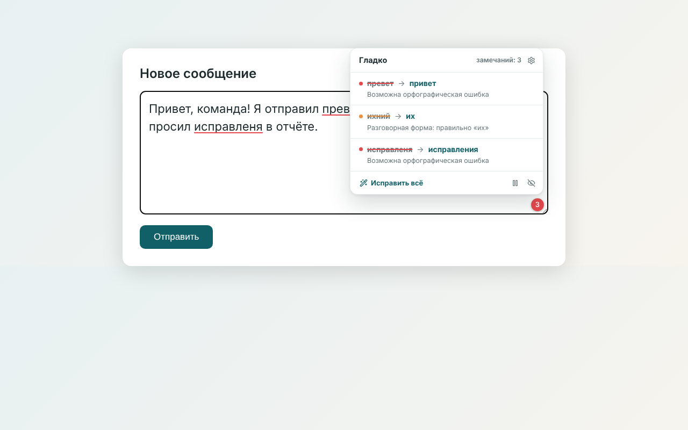
</details>

## 📦 Установка

| Браузер | Как поставить |
|---|---|
| **Firefox** | **[Установить из каталога Firefox Add-ons](https://addons.mozilla.org/ru/firefox/addon/%D0%B3%D0%BB%D0%B0%D0%B4%D0%BA%D0%BE-%D0%BF%D1%80%D0%BE%D0%B2%D0%B5%D1%80%D0%BA%D0%B0-%D0%B3%D1%80%D0%B0%D0%BC%D0%BC%D0%B0%D1%82%D0%B8%D0%BA%D0%B8/)** — подписано Mozilla, обновляется автоматически |
| **Chrome / Edge / Brave** | Chrome Web Store — *скоро*. Пока: скачайте `gladko-chrome-*.zip`, распакуйте, откройте `chrome://extensions`, включите «Режим разработчика» → «Загрузить распакованное расширение» |


## 🔧 Серверы проверки

В настройках расширения выберите, куда отправлять текст:

| Режим | Что это | Приватность |
|---|---|---|
| **Автоматически** | свой локальный сервер, если запущен, иначе публичный | зависит от наличия локального |
| **Локальный** | `localhost:8081`, без лимитов | текст не покидает компьютер |
| **Публичный** | `api.languagetool.org` | текст уходит на сервер LanguageTool; есть лимиты |
| **Premium** | `api.languagetoolplus.com`, нужен e-mail и API-ключ | как у публичного, лимиты выше |
| **Свой адрес** | любой сервер LanguageTool; доступ запрашивается отдельно | на ваше усмотрение |

Запустить локальный сервер проще всего через Docker:

```bash
docker run -d --name languagetool -p 8081:8010 erikvl87/languagetool
```

## 🔐 Приватность

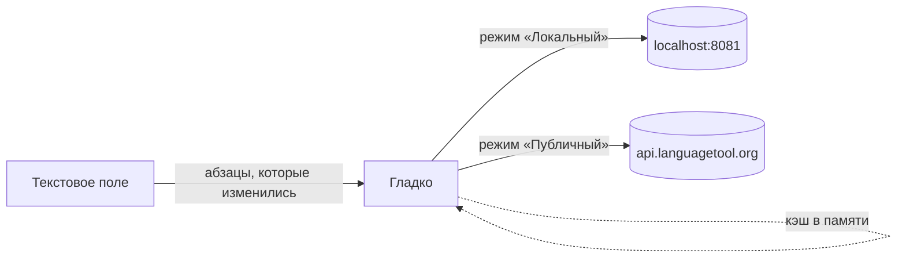

Расширение не читает поля паролей, не собирает и не хранит ваши тексты, не содержит аналитики и удалённого кода. Подробности — в [политике конфиденциальности](store/PRIVACY_POLICY.md).

## 🛠️ Разработка

Один код, две сборки: Firefox (Manifest V2) и Chrome (Manifest V3).

```bash
git clone https://github.com/Oxyg1/gladko.git && cd gladko
npm install
npm test                # юнит-тесты
npm run build           # dist/firefox, dist/chrome и zip-архивы
npm run lint:firefox    # web-ext lint
npm run e2e             # сквозной тест в настоящем Chromium (нужен playwright)
```

```
src/         общий код расширения (content, background, настройки, переводы)
manifests/   манифесты Firefox и Chrome
scripts/     сборка и генерация скриншотов
test/        юнит-тесты и e2e
store/       тексты и материалы для AMO и Chrome Web Store
docs/        баннер, скриншоты, брендбук
```

Подробнее о том, как помочь проекту, — в [CONTRIBUTING.md](CONTRIBUTING.md).

## 🗺️ Планы

- [ ] Офлайн-проверка орфографии (Hunspell) без сервера
- [ ] Кнопка «Улучшить текст» через LLM по собственному ключу пользователя
- [x] Публикация в каталоге Firefox
- [ ] Публикация в Chrome Web Store

## 📄 Лицензия и благодарности

Код распространяется под лицензией [MIT](LICENSE). Логотип и фирменный стиль — в [docs/brand](docs/brand/GUIDELINES.md).

Проверку выполняет [LanguageTool](https://languagetool.org) (LGPL). Гладко — независимый проект и не связан с LanguageTool.
